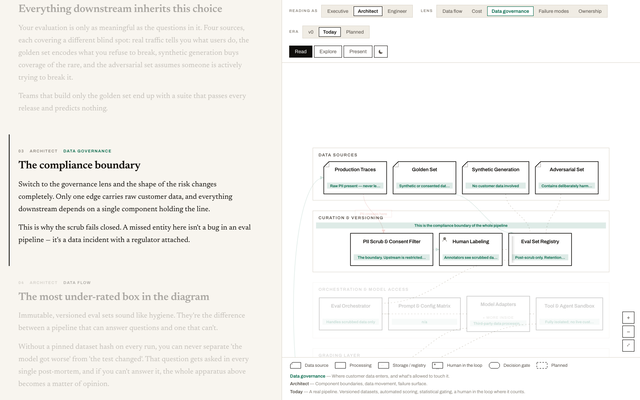

# agent-skills

[](LICENSE)
[](https://github.com/vibbs/agent-skills/actions/workflows/validate.yml)

A collection of reusable skills for AI coding agents. Each skill is a folder with a
`SKILL.md` and any supporting references, assets or scripts, written to the open
[Agent Skills specification](https://agentskills.io/specification) so it works in any
agent that supports the format, not just one. It is for developers who want to drop
well-tested, general-purpose workflows into Claude Code, Codex, Cursor, Copilot and
similar tools. This repository holds skills only; installation uses existing tools.

## Install

### Any agent: `skills` CLI

The [`skills` CLI](https://github.com/vercel-labs/skills) installs skills into the
agent directories it detects (Claude Code, Codex, Cursor, GitHub Copilot, Gemini CLI,
OpenCode, Windsurf and others).

```bash
npx skills add vibbs/agent-skills
```

Install a single skill:

```bash
npx skills add vibbs/agent-skills --skill architecture-explainer
```

Useful flags: `--list` shows the available skills without installing, `-a <agent>`
targets specific agents (for example `-a claude-code codex`), `-g` installs for your user
instead of the current project, and `-y` skips prompts.

### Claude Code: plugin marketplace

In Claude Code:

```
/plugin marketplace add vibbs/agent-skills
/plugin install vibbs-agent-skills@vibbs-agent-skills
```

Or from a shell:

```bash
claude plugin marketplace add vibbs/agent-skills
```

```bash
claude plugin install vibbs-agent-skills@vibbs-agent-skills
```

The plugin installs every skill in this repository. Plugin skills are namespaced, so
skills appear as `vibbs-agent-skills:<skill-name>`. Only `skills/` is copied into the
plugin cache.

Adding the marketplace clones the whole repository, including the preview media under
`docs/`. To check out only what the plugin needs, add it with a sparse checkout:

```bash
claude plugin marketplace add vibbs/agent-skills --sparse /.claude-plugin /skills
```

Keep the leading slashes. Without them, `skills` also matches `docs/skills/`, and the
preview media gets checked out anyway.

### Claude apps (web and desktop): upload a ZIP

Untested. In claude.ai and the Claude desktop app (outside the Code tab, which uses the
plugin instructions above), custom skills are installed by uploading a ZIP. Package the
skill folder itself, so the ZIP's root is the folder, not the repository:

```bash
cd skills && zip -r ../architecture-explainer.zip architecture-explainer
```

Then, in Claude, open Customize > Skills (Settings > Capabilities in some versions), click
"+", choose "Create skill", then "Upload a skill", and select the ZIP. Skills require code
execution to be enabled; on Free, Pro and Max plans that is under Settings > Capabilities.
Uploaded skills are private to your account. See
[Use Skills in Claude](https://support.claude.com/en/articles/12512180-use-skills-in-claude).

Skills uploaded this way run in Claude's code execution sandbox, not on your machine, so
anything a skill installs or downloads depends on that sandbox's network access.

### Manual

Copy a folder from `skills/` into your agent's skills directory (for example
`.claude/skills/` or `.agents/skills/`). Per-agent manual instructions are untested.

## Skills

Previews and longer write-ups are in the [catalog](docs/catalog.md).

<!-- catalog:begin -->
| Preview | Skill | Description | When it triggers |
|---|---|---|---|
| <a href="docs/skills/architecture-explainer/"></a> | [`architecture-explainer`](docs/skills/architecture-explainer/) | Build an interactive, self-contained HTML architecture explainer. | Use whenever the user wants to visualize or explain a system: "how does X work", "diagram our architecture", "system overview", "component map", "explain this pipeline", "make a diagram for the blog / for a client / for the docs", HLD or LLD, data flow, or turning a codebase or design doc into something a reader can explore. |
<!-- catalog:end -->

## Compatibility

Tested so far:

- Installation with `npx skills add` from a local checkout, into a temporary project
  directory, for the `claude-code` and `codex` targets.
- The Claude Code plugin and marketplace manifests pass `claude plugin validate`, and
  `claude plugin marketplace add` / `claude plugin install` succeed from a local checkout
  (Claude Code 2.1.302).

Skill behaviour has not yet been tested end to end in any specific agent. This list is
updated as testing happens.

## Bundled scripts

Some skills ship scripts (for example, a build linter or a screenshot checker). Nothing
runs automatically on install; scripts run only when an agent or you invoke them, and
the agent normally asks before running commands. Each skill's `README.md` lists its
scripts and what they need. Read them before running them.

## Creating a new skill

1. Create `skills/<skill-name>/SKILL.md`. The folder name must equal the `name` field.

   ```
   skills/<skill-name>/
   ├── SKILL.md        required: frontmatter (name, description) + instructions
   ├── README.md       short human-facing summary and example
   ├── references/     optional: docs the agent reads on demand
   ├── scripts/        optional: executable code
   └── assets/         optional: templates, data, static files
   ```

   Write the `description` as what the skill does followed by a "Use when ..." sentence.
   The catalog below is generated from it.

2. Validate it (requires [uv](https://docs.astral.sh/uv/)):

   ```bash
   scripts/validate.sh
   ```

3. Add its overview page and, optionally, preview media. These live outside the skill
   so installs stay lean:

   ```
   docs/skills/<skill-name>/
   ├── README.md       overview: what it does, when to use it, install
   └── media/          optional, each file 2 MB or less
       ├── preview.png thumbnail shown in the skills table
       └── tour.gif    full preview shown in the catalog
   ```

4. Regenerate the skills table and catalog, then check the docs:

   ```bash
   scripts/update-catalog.py
   ```

   ```bash
   scripts/check-docs.py
   ```

5. Open a pull request. CI runs the validator, checks the table and catalog are current,
   checks the docs and media, and validates the Claude Code manifests.

## Contributing

See [CONTRIBUTING.md](CONTRIBUTING.md). Skills must be general-purpose, follow the spec,
and pass validation; one skill per pull request.

## License

[MIT](LICENSE) © Vaibhav Doddihal
