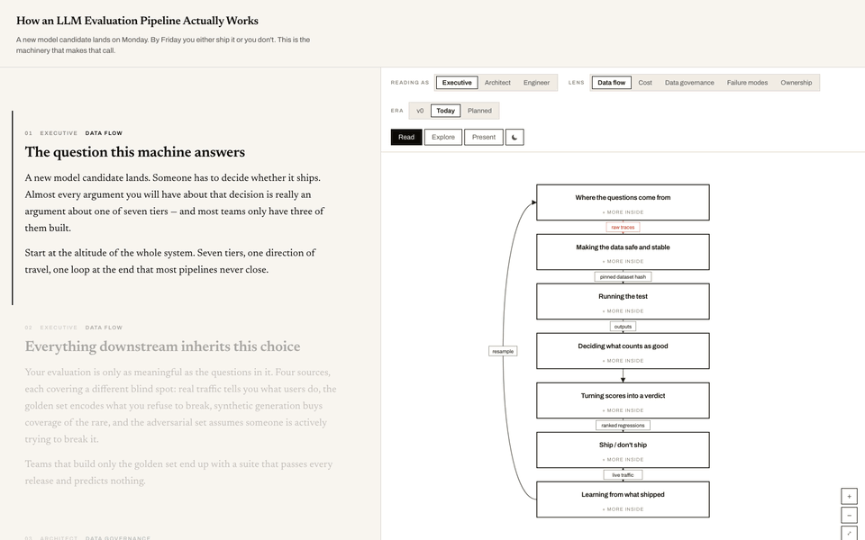

# architecture-explainer

Turns a description of a system into one self-contained, interactive HTML explainer. You
author the topology once, and readers move through it four ways:

- **Personas:** executive, architect and engineer views of the same system, with
  different vocabulary and depth.
- **Lenses:** data flow, cost, governance, failure modes and ownership. Each lens brings
  its own edges and colour.
- **Eras:** how the system looked before, today, and as planned.
- **A narrated tour:** the prose drives the camera and switches lens and era as it goes.

The output is a single `.html` file with no network calls. You can host it anywhere,
embed it in an `<iframe>`, or open it offline.



*Read mode of the bundled example (an LLM evaluation pipeline). Each section of prose
selects a persona, lens and era, and the diagram follows.*

## When to use it

The agent reaches for this skill when you want to explain or visualise a system: "how
does X work", "diagram our architecture", a pipeline write-up, an HLD/LLD, or turning a
codebase or design doc into something a reader can explore. It suits a system with
nested groups, more than one audience, or readers who won't have you there to walk
them through it.

It is not for live dashboards or diagrams you keep editing by hand; use drawio for those.

## What the agent does

1. **Interviews you before drawing anything:** tiers, components, one end-to-end request,
   the audiences, which concerns matter, and the argument the explainer should make.
2. **Writes a spec,** a plain JS module holding the topology, edges and narrative beats.
3. **Builds it.** A linter enforces the rules: every node has a `why`, the tour has beats
   with real prose, and every lens has its own edges. Vite then inlines everything into
   one file.
4. **Checks it visually** at desktop and phone sizes before handing it over.

## Install

```bash
npx skills add vibbs/agent-skills --skill architecture-explainer
```

Claude Code users can install the whole collection as a plugin instead; see the
[repository README](../../../README.md#install).

## Requirements

- Node.js 18+ and network access for `npm install`.
- Playwright with Chromium for the screenshot check.

## Links

- [Skill source](../../../skills/architecture-explainer/)
- [Spec format reference](../../../skills/architecture-explainer/references/spec-format.md)
- [Catalog](../../catalog.md)
