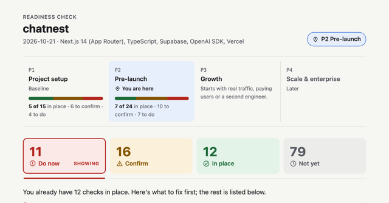

# readiness-check

Reviews a project's production readiness by phase and says what to skip for now.

## The problem

People shipping AI-built apps often don't know which production concerns matter yet.
The usual answer is a flat checklist of a hundred topics, from logging and backups to
Kubernetes and multi-region failover, with no sense of order. Faced with that, people
either freeze, or try to do all of it before launch and spend weeks on infrastructure
the app won't need for a year. Meanwhile the gaps that matter on launch day, such as an
API key shipped to the browser or a database table anyone can read, sit in the same
list as everything else.

## How it solves it

The skill reviews the repository against a roadmap that gives every item an order:

- **Phase:** when the item first needs attention, started by an event rather than a date.
  P1 project setup starts at `git init`. P2 pre-launch starts when someone other than you
  is about to use it, or real data is about to go in. P3 growth starts with real traffic,
  paying users or a second engineer. P4 scale and enterprise starts when a customer, a
  compliance requirement or the budget forces it.
- **Level:** the seniority of the engineer who'd remember it, from beginner to advanced.
- **Overrides:** cards keyed by domain and region that pull items forward. AI features
  pull rate limiting, token budgets and prompt-injection defence into pre-launch; EU users
  pull in GDPR and WCAG 2.1 AA accessibility. Region cards are grouped by what they pull,
  not by country: one card covers the many privacy laws that ask for the same work, one
  covers data-localisation rules, and a "global" answer applies the privacy cards
  together.

From that, the report answers three questions: where you are, what your current phase
needs, and what to skip for now. Each item is marked **do now**, **confirm**, **in
place** or **not yet**:

- Every finding cites evidence, a `file:line` or a config file.
- Anything that lives outside the repo, such as backups, uptime alerts or DNS, is marked
  "confirm", never "missing".
- Every gap comes with a ready-to-paste prompt for your coding agent, naming the real
  files in your repo.
- A "skip for now" line names the usual over-builds (Kubernetes, caching, message queues,
  sharding, multi-region) that can wait.
- Anything from a later phase that you've already built gets a gentle question about
  upkeep, not a telling-off.

The output is `readiness-check.md` at the project root and a one-page HTML report with
no network requests, in light and dark mode, that most people will actually read.



## When to use it

Ask your agent "is this ready to launch?", "what am I missing before going live?",
"review my app for production" or "what should I add next?". It suits vibe-coded and
AI-built apps that are about to meet real users, and teams that want a short, ordered
answer instead of a long checklist.

This version reviews P1 and P2 in depth and previews the next phase. If your project is
already in growth or scale, it says so, checks the P1–P2 baseline, and previews what's
next; deeper P3 and P4 review is planned. It doesn't fix code, track progress between
runs, or run in CI.

## What the agent does

1. **Loads any earlier answers** from `readiness-check.md`, so it never asks twice.
2. **Scans the repo** for the stack, deploy setup, auth, data layer and LLM SDKs, with
   specific signals for Next.js, Express, FastAPI, Django, Flask, Supabase (including
   whether row-level security is on) and Firebase.
3. **Asks at most six short questions** the repo can't answer: who uses it, whether
   there's real traffic, B2B or B2C, domain flags, where users are, and multi-tenancy.
4. **Decides the phase and overrides,** then classifies every in-scope item.
5. **Writes `readiness-check.md`** and renders a dated report, `.readiness/report-<date>.html`,
   stamped with the check date and commit. Earlier reports and the previous
   `readiness-check.md` are kept, never overwritten. It asks before
   touching `.gitignore` and never changes your code.

## Install

```bash
npx skills add vibbs/agent-skills --skill readiness-check
```

Claude Code users can install the whole collection as a plugin instead; see the
[repository README](../../../README.md#install).

## Requirements

None for the review. The HTML renderer needs Python 3.8+ (standard library only); without
it, the agent fills the report template by hand.

## Credits

The roadmap is based on a list of 111 production topics that vibecoders tend to forget,
from a [public post](https://www.instagram.com/p/DehMUh_jdbK/), sorted into phases,
levels and overrides for the BlockSimplified Vibecoder Production Roadmap. The idea of a
senior-engineer skill that reviews and recommends was inspired by the review commands in
[Ponytail](https://github.com/DietrichGebert/ponytail).

The regulatory overrides say which engineering items to bring forward. They are not legal
advice.

## Links

- [Skill source](../../../skills/readiness-check/)
- [Item catalog](../../../skills/readiness-check/references/items-p1-p2.md)
- [Catalog](../../catalog.md)
